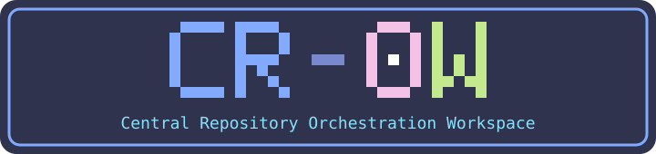
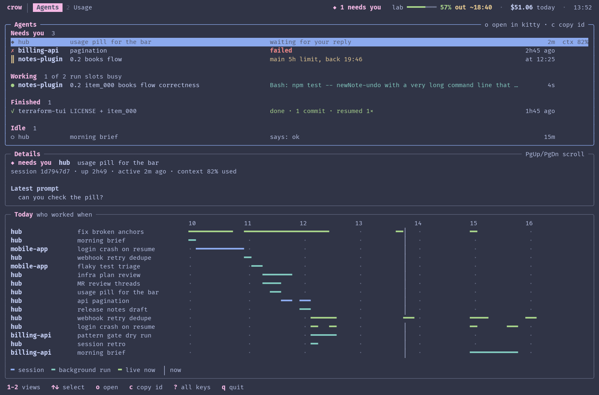
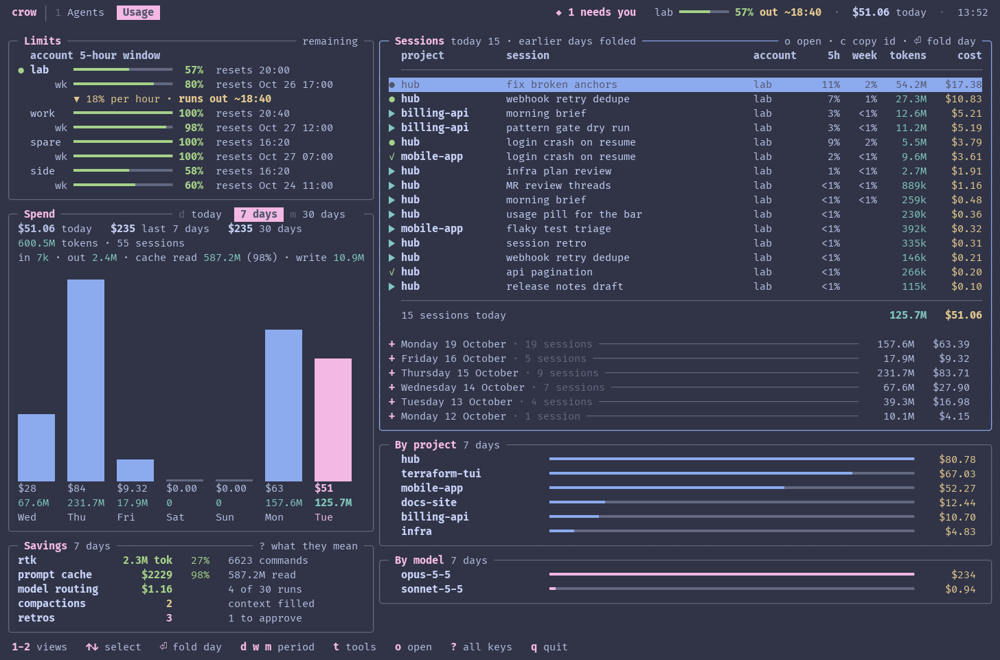
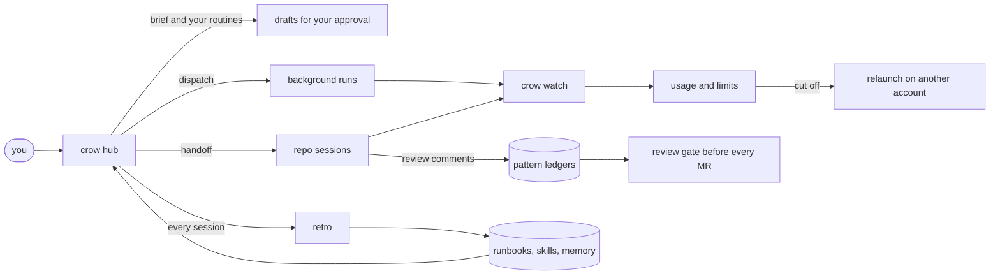

<div align="center">



### Run your repos, your agents and your Claude budget from one terminal.

[](LICENSE)




<sub>`crow watch`, the live board. Sample data, rendered in a kitty theme.</sub>

</div>

---

Crow sits above your projects. It briefs you every morning, runs background agents,
watches every token and limit across your accounts, rescues sessions that hit a usage cap,
and learns from each review comment and each correction you make.

```sh
git clone https://github.com/Nicolas-Rigaudy/cr-0w && cd cr-0w
export PATH="$PWD/bin:$PATH"
crow brief      # one screen: what needs you today
crow watch      # the live board (builds itself on first run)
```

## Why you want it

| You have | Crow gives you |
|---|---|
| Five repos and three agents running | **One board.** What needs your reply, what is working, what failed, what finished |
| A usage cap at the worst moment | **A rescue.** The cut-off session is registered and relaunched on another allowed account |
| A bill you only see at month end | **Live burn rate.** "Runs out ~18:40", cost per session, per project, per model |
| The same review comment every week | **A ledger.** Each comment becomes a pattern that is checked on every future diff |
| The same correction every session | **A memory.** Retros turn it into a runbook, a skill or a note, once |
| Rules you hope the agent follows | **Hooks.** Commit format, push approval and no-merge are enforced, not requested |

## The tour

### See everything: `crow watch`
Two tabs on keys `1` and `2`. The board uses your terminal's 16 colours, so it follows your theme.

**Usage.** Headroom per account and window with a burn-rate forecast, spend over today, 7 or 30 days (`d` `w` `m`),
what your savings tools saved, and cost by project and by model.
Today's sessions are listed with their share of the limit. Earlier days are folded under a header; Enter opens one.



### Start the day: `crow brief`
Reviews waiting on you first, then sprint, open MRs and PRs, open threads, background runs and repos left dirty.
It ends with a suggested top three.

### Your own routines
The hub is the orchestrator. The rituals around it are yours. `examples/skills/` has a stand-up (`daily`) and a
week rollup (`weekly`) to copy into `local/hub-skills/` and bend to your team: format, language, where it posts.
A routine drafts, you approve, then it posts. See [`runbooks/own-routines.md`](runbooks/own-routines.md).

### Delegate without babysitting
`crow dispatch` starts a tracked background run in a repo. `crow runs` shows its status, task and commits so far.
The `afk` skill prepares an unattended run: it checks the machine, asks every open question up front,
queues jobs in worktrees, and writes a return report. A pre-push denylist keeps the night safe.

### Never lose a session to a limit
```sh
crow sessions                 # sessions cut off by a usage limit
crow relaunch <id> <account>  # continue on another allowed account (dry run first)
```

### Get better with every review
`review-threads` turns each reviewer comment on your MR into a pattern in a ledger.
The `review` skill applies that ledger to every diff: peer review, self review, and a gate before any MR opens.
Reviewers stop repeating themselves.

### Learn from you
After every session an automatic retro finds where you corrected or redirected the work, then writes the lesson
into a runbook, a skill or a memory. Memory is stored once and linked into each allowed account, never copied.

## How it fits together



The hub never runs a repo's own hooks. Deep work is handed to a session inside that repo with a hand-off note
(`crow handoff`), and a guard asks before any commit, push, rebase or MR on a registered repo.

## Safe by default

| Action | Work repos | Personal repos |
|---|---|---|
| Commit | branch only, never main | yes |
| Push | explicit OK each time | yes |
| Merge | never | yes |
| Send mail, post to chat | draft first, wait for OK | draft first, wait for OK |
| Background runs | max 2, allowed accounts only | same |

Commit subjects are `type[SCOPE]: message`, checked by a commit-msg hook. The full rule set is in [`CLAUDE.md`](CLAUDE.md).

## Setup

1. Install [cdx](https://github.com/AlexAgo83/cdx-manager) and Claude Code, then clone this repo.
2. `mkdir local && git -C local init`, then add `local/context.md`, `local/projects.yaml` (project registry) and `local/accounts.yaml` (start from [`docs/accounts.example.yaml`](docs/accounts.example.yaml)).
3. Put `bin/` on your PATH and run `crow`.

Everything outside `local/` is generic. Your people, accounts, projects, memory and state live in `local/`,
which is ignored by this repo and meant to be its own private repo.

<details>
<summary><b>What is in the box</b></summary>

| Path | What |
|---|---|
| `bin/crow` | launcher: hub session, one-shot briefs, project sessions, run dispatch, `crow watch` |
| `bin/crow-runs`, `bin/crow-usage`, `bin/crow-activity` | background runs, usage and cost across accounts, git/MR activity |
| `bin/crow-accounts`, `bin/crow-memory` | account policy, and memory stored once in `local/memory` and linked into allowed profiles |
| `bin/crow-sessions`, `bin/crow-relaunch` | registry of sessions cut off by a usage limit, and the guarded relaunch |
| `bin/crow-retro`, `bin/crow-digest` | automatic retrospective after every session |
| `bin/crow-tidy`, `bin/crow-releases` | repo hygiene report with safe cleanup, release-track progress |
| `bin/ansi-shot` | render any terminal output to a PNG in your own theme (how the screenshots here are made) |
| `tools/crow-watch` | the terminal board (Go, Bubble Tea) |
| `integrations/` | optional desktop-shell widgets |
| `skills/`, `.claude/skills/` | brief, review, review-threads, mr, wrap, afk, retro |
| `examples/skills/` | starting points for your own routines (daily, weekly) |
| `runbooks/` | short tested procedures |
| `logics/` | the project's own requests, backlog and tasks (Logics workflow) |

</details>

<details>
<summary><b>Develop</b></summary>

- Tests for the helpers: `python3 -m pytest tests`
- Board tests: `cd tools/crow-watch && go test ./...`
- Regenerate the screenshots: [`docs/screenshots.md`](docs/screenshots.md)
- Procedures: [`runbooks/`](runbooks/README.md)

</details>

## License
MIT, see [`LICENSE`](LICENSE).
