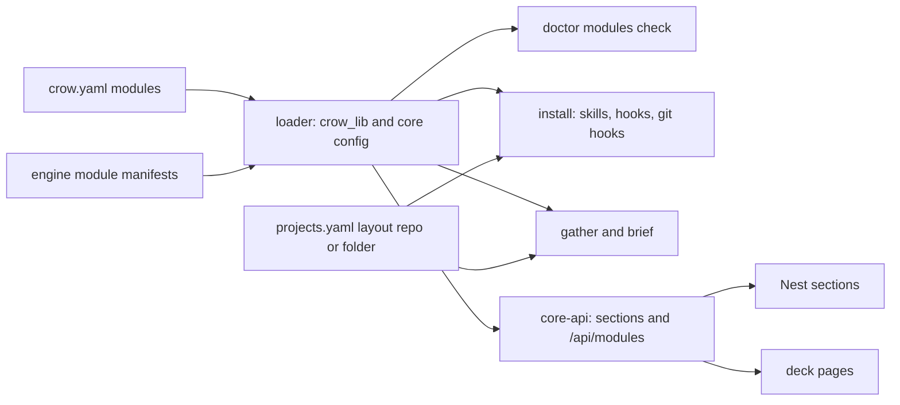

## adr_002_crow_bricks_module_manifest_and_project_kinds - Crow bricks, module manifest and project kinds
> Date: 2026-11-19
> Status: Proposed
> Owner review: pending
> Related request: `req_064_paul_s_feedback_and_a_modular_public_crow`, `req_047_make_the_hub_rules_configurable_in_local_policy_yaml`, `req_051_adopt_ideas_from_life_distributable`
> Related backlog: `item_235_module_design_for_a_public_crow_bricks_manifest_and_project_kinds`, `item_122_crow_home_is_the_private_config_repo_itself`
> Related task: (none yet)
> Drivers: a second user installs only what fits; a folder without git is a valid project; the owner's setup keeps working unchanged; one switch per brick; Nest and deck show nothing for a brick that is off.
> Reminder: Update status, linked refs, decision rationale, consequences, and follow-up work when you edit this doc.

# Overview
Crow is one always-on core plus optional bricks. One manifest, `crow.yaml` at the CROW_HOME root (`local/crow.yaml` in a checkout), turns bricks on and holds their config. Each brick ships an engine-side module manifest that lists what it owns. Projects are `repo` or `folder`. crow-core is the back brick with a versioned contract; Nest and the deck are front bricks that hide what is off.



# Context
- Every script assumes a forge, MRs, an issue tracker, mail and a vault. A second user works alone in a folder with no git and no forge; MR features, commit rules and `crow-activity` git reads make no sense there.
- Config already in place: `local/projects.yaml` (identities, vault, projects with `scope`, `forge: gitlab | github | none`, and `kind: work | tool | world | notes` for the Nest planet type), `local/accounts.yaml` (account policy and scope ranks), `local/tools.yaml`, `local/deck.conf`.
- `kind` is taken by the Nest planet type (item_214). The repo or folder split needs its own key.
- Skills: hub skills sit in `.claude/skills/` (loaded by Claude in the hub) and `skills/` (linked into each account profile by `crow-memory link`; `crow-doctor` checks those links). Third-party design skills come from `skills/ext.list` through `crow-skills-ext`.
- Hooks: `.claude/settings.json` runs `crow-hub-guard`, `crow-runs inbox --hook`, `crow-relaunch hook` and `crow-design-notes hook`. Git hooks call `crow-commit-msg-check`, `crow-precommit-check` and `crow-prepush-check`.
- crow-core serves `/api/state` from the store (inbox, missions, runs) plus nine bin/ script sections and `jobs` (`tools/crow-core/serve_cmd.go`). The deck reads the same scripts. Contracts live in `logics/specs/core_contract` and `logics/specs/script_contract`.
- req_047 moves the commit format and the autonomy table to `local/policy.yaml`. item_122 makes CROW_HOME the private config repo itself, files at its root.
- Nest pages today: Home, Inbox, Missions, Desk, Chat (Ops and Reports planned in req_063). Deck pages: Home, Agents, MRs, Projects, Usage.

# Decision
## Bricks
| Brick | Owns | Default |
| --- | --- | --- |
| `core` | dispatcher `crow`, runs, sessions, accounts, registry, doctor, check, state, memory, usage, room, prompts, hub guard, gather, brief and wrap skills, install and update | always on |
| `git` | commit-msg, pre-commit and pre-push hooks, `crow-activity` git reads, `crow-tidy`, identity check, worktrees | on (applies to `repo` projects only) |
| `forge` | `crow-mrs`, `crow-forge-read`, review run and check, skills `mr`, `review`, `review-threads`, MRs section and deck page | on |
| `vault` | `crow-note`, `crow-notes`, `crow-log`, vault helpers and migration, `eod` skill, open threads in the vault | on |
| `mail` | `crow-today` (calendar and mail counts), `/api/today` done and snooze, Today box | on |
| `team` | `crow-checks` (sprint rituals, 1:1s, mail to answer), checks section | on |
| `afk` | afk page and preflight, `afk` and `night` skills, afk runbook | on |
| `retro` | `crow-retro`, `crow-digest`, `crow-cost-audit`, `crow-toolwatch`, `retro` skill | on |
| `design` | screenshot, crop and compare tools, design notes hook, third-party design skills | off |
| `releases` | changelog, release propose, releases view | on |
| `core-api` | `tools/crow-core`: store, inbox, missions, butler, every `/api` route, the contract | on |
| `nest` | `tools/nest` web front | on, needs `core-api` |
| `deck` | `tools/crow-deck`, `tools/crow-watch` terminal front | on |
| `integration-shell` | `integrations/archeotech` and its runbooks | off |

Defaults are the values for an existing setup with no `crow.yaml`. The install writes a starter file (see Install).

## Inventory
Source of truth: `logics/specs/module_inventory/bricks.tsv` (kind, name, brick). `logics/specs/module_inventory/inventory.py` lists every bin/ script, skill, runbook, Claude hook, git hook, core route, core section, app and integration, and joins the tags. `tests/test_module_inventory.py` fails on an untagged piece, a stale tag or an unknown brick, so `bin/crow-check` keeps the table complete. `python3 logics/specs/module_inventory/inventory.py --markdown` prints the full table (170 rows on 2026-11-19).

| Brick | Pieces | Scripts | Skills | Runbooks | Hooks | Core routes and sections | Apps |
| --- | --- | --- | --- | --- | --- | --- | --- |
| core | 48 | crow, crow-accounts, crow-check, crow-ctx, crow-doctor, crow-focus, crow-gather, crow-hub-guard, crow-isolation-probe, crow_lib.py, crow-memory, crow-open, crow-project, crow-prompt, crow-ready, crow-registry, crow-relaunch, crow-room, crow-runs, crow_schema_lite.py, crow-screen, crow-secret, crow-sessions, crow_sidecar.py, crow-state, crow_term.py, crow-update, crow-usage | brief, wrap | agent-tooling, claude-and-codex, dispatch-background-runs, install-and-update, interrupted-sessions, live-claude-session-test, logics-task-closeout, long-sessions, memory, new-account, open-project-session, own-routines, remote-computer-use-windows, service-tokens, sub-project-work | crow-hub-guard, crow-runs inbox, crow-relaunch hook | | |
| core-api | 39 | crow-contract, crow_contract.py | | core-service, mission-e2e-scratch | | 27 routes (state, events, missions, inbox, sessions, dispatch, butler, terminal); sections sessions, dispatch, usage, projects, accounts, ready, jobs | tools/crow-core |
| git | 9 | crow-activity, crow-commit-msg-check, crow-precommit-check, crow-prepush-check, crow-tidy | | repo-tidy | commit-msg, pre-commit, pre-push | | |
| forge | 10 | crow-forge-read, crow-mrs, crow-review-check, crow-review-run | mr, review, review-threads | ci-secrets, review-findings | | section mrs | |
| vault | 9 | crow-log, crow-note, crow-notes, crow-vault-migrate, crow_vault.py | eod | open-threads, vault-capture, vault-sync-new-device | | | |
| mail | 5 | crow-today | | graph-today | | routes today done and snooze; section today | |
| team | 3 | crow-checks, crow_checks.py | | | | section checks | |
| afk | 7 | crow-afk-page, crow-afk-preflight, crow-night-page, crow-night-preflight | afk, night | afk-runs | | | |
| retro | 8 | crow-cost-audit, crow-digest, crow-retro, crow-toolwatch | retro | cost-audit, session-retros, tool-update-watch | | | |
| design | 12 | ansi-shot, crow-compare, crow-crop, crow-design-notes, crow-skills-ext | skills/ext.list | design-canvas, design-references-in-items, design-sessions, headless-webgl-render, visual-concepts | crow-design-notes hook | | |
| releases | 5 | crow-changelog, crow-release-propose, crow-releases | | readme-showcase, releases | | | |
| deck | 9 | | | tui-agents-ux, tui-home-ux, tui-projects-ux, tui-render, tui-review-ux, tui-themes-ux, tui-usage-ux | | | tools/crow-deck, tools/crow-watch |
| nest | 3 | | | nest-phone-install, nest-screenshots | | | tools/nest |
| integration-shell | 3 | | | archeotech-crow-agents, archeotech-crow-usage | | | integrations/archeotech |

## Module manifests (engine side)
- Each brick gets `modules/<brick>.yaml` in the engine. It replaces `bricks.tsv` once written; the inventory test then reads the manifests.
- Fields: `name`, `summary`, `requires` (other bricks), `scripts`, `skills`, `claude_hooks`, `git_hooks`, `core_sections`, `core_routes`, `gather` (routine keys it adds to brief, daily, weekly), `doctor` (checks it owns, tools it needs on PATH), `nest` (sections), `deck` (pages and boxes), `config` (allowed keys with defaults).
- Files stay where they are. A manifest lists paths; moving folders is not part of any split.

```yaml
# modules/forge.yaml
name: forge
summary: Merge requests and reviews on GitLab or GitHub.
requires: [git]
scripts: [crow-mrs, crow-forge-read, crow-review-run, crow-review-check]
skills: [mr, review, review-threads]
core_sections: [mrs]
gather: {brief: [mrs], daily: [mrs]}
doctor: {needs_any: [glab, gh]}
nest:
  sections:
    - {id: mrs, page: desk, title: Merge requests, source: mrs, view: mrs}
deck:
  pages: [MRs]
config:
  hosts: {}          # forge name -> host, empty = public hosts
```

## crow.yaml (owner side)
- Lives at the CROW_HOME root (item_122); in a checkout, `local/crow.yaml`.
- `modules:` maps a brick to `true`, `false` or a mapping with `on:` and that brick's config keys.
- A missing file or a missing brick key means the default from the Bricks table. The owner's setup needs no file to keep today's behaviour.
- Unknown brick names, unknown config keys and broken `requires` are doctor failures, never silent.
- Policy stays in `policy.yaml` (req_047): crow.yaml says which bricks exist, policy.yaml says what crow may do.
- `vault:` and `identities:` stay in `projects.yaml` for now. A later item may move `vault.path` under `modules.vault`.

```yaml
# crow.yaml
version: 1
modules:
  forge: false
  mail: false
  team: false
  design: false
  vault:
    on: true
    notes_dir: Crow          # folder inside the vault for crow notes
  nest:
    on: true
    core_url: http://127.0.0.1:8787
  core-api:
    on: true
```

## Loader and doctor
- One loader per language: `crow_lib.modules()` in Python, `config.Modules` in crow-core, `crow modules` (and `crow modules json`) for shell and the deck. It merges defaults, crow.yaml and the engine manifests and returns the on set with config.
- `crow-doctor` gets a `modules` check: file parses, names and keys known, `requires` met, each on brick's `doctor.needs` present. Checks owned by an off brick do not run (no forge, identity or vault warnings for a setup without them).

## What "off" does
| Surface | Off brick |
| --- | --- |
| Skills in `skills/` | `crow-memory link` skips them; doctor expects no link |
| Skills in `.claude/skills/` | moved to `skills/`; install links on bricks into `.claude/skills/` (generated, ignored by git) |
| Claude hooks | stay in `settings.json`; the hook script exits 0 at once when its brick is off |
| Git hooks | installed only in `repo` projects while `git` is on |
| gather, brief, daily, weekly | the brick's gather keys are not collected; the skill text reads the on set from the gather JSON |
| crow-core | its sections are not served, its routes answer 404 `module off` |
| Nest, deck | its sections, pages and boxes are hidden |
| `crow` subcommands | print `crow: module <name> is off (crow.yaml)` and exit 2 |

## Project kinds
- New key `layout: repo | folder` in each `projects.yaml` entry. `kind` keeps the Nest planet type.
- Default when absent: `repo` when the path holds `.git`, else `folder`. Existing entries need no edit.
- `repo`: git activity, identity check, commit and push hooks, worktrees, `crow-tidy`; forge steps when `forge` is not `none` and the forge brick is on.
- `folder`: activity from files changed since the date (mtime walk with the registry's ignore list), no identity check, no hooks, no worktrees. Dispatch runs in the folder itself with no branch. Logics still works when the folder has a `logics/` dir.
- `forge` on a folder project is a doctor failure.

## Front and back
- `core-api` is the back brick. Its contract is versioned in `logics/specs/core_contract` with `contract_version` in every `/api/state` response. crow-check runs the contract check.
- New `GET /api/modules`: `{contract_version, modules: [{name, on, sections, nest: {sections}, deck: {pages}}]}`. Fronts read it at start and after a `modules` event.
- Nest is a static build. Its config is the core URL and a token; it builds once and runs against any core.
- Nest navigation comes from `/api/modules`. A page shows when at least one of its sections is on. Sections render with components shipped in the Nest bundle. A manifest may name a built-in view or the generic list view over its section JSON; no code is loaded at runtime.
- The deck reads `crow modules json` (core may be off) and hides pages and boxes the same way.

## Nest is the panel
- The local panel with plug-in sections is Nest. A brick adds a panel entry by declaring a Nest section in its manifest and a core section that serves its data. No second server.
- A brick from outside the engine (a user's private brick in CROW_HOME `modules/`) can declare a section that uses the generic list view and a bin/ script under the script contract.

## Install
- `install.sh` asks which optional bricks to turn on (or `--modules forge,vault,...`) and writes the starter `crow.yaml`. Without an answer it writes `core`, `git`, `core-api`, `nest`, `deck` on and the rest off.
- `crow modules on <brick>` and `off <brick>` edit crow.yaml and rerun the link step.

## Migration order
Each split is one backlog item, run in this order, interleaved with req_063 as its Execution order says.
1. Module manifests, crow.yaml loader and doctor check: engine manifests from bricks.tsv, crow.yaml loader in Python, Go and `crow modules`, doctor check. No behaviour change.
2. Skills, hooks and gather follow the module switch: skill links, `.claude/skills` generation, hook early exit, gather keys, `crow` subcommand guard.
3. `item_236_first_module_split_forge_mrs_optional_and_folder_projects`: forge off and `layout: folder`.
4. `item_237_nest_and_crow_core_as_separate_front_and_back_bricks`: `/api/modules`, Nest and deck hide off bricks, Nest config and install docs.
5. Mail, team and vault bricks optional, with notes falling back to CROW_HOME.
6. Optional tool bricks and install profiles: afk, retro, releases, design and shell integration as switches; `install.sh` module prompt.

# Alternatives considered
- **Flags in `projects.yaml`**: one file less, but bricks are per install and projects are per repo; mixing them grows a file that is already long. Rejected.
- **One `modules:` block inside `policy.yaml`**: policy is about permissions; a missing policy falls back to defaults while a wrong module set should fail loudly. Rejected.
- **Separate repos or packages per brick**: clean for a public release, heavy while the engine changes daily. Deferred until the manifests are stable.
- **Runtime plugins in Nest** (load a brick's JS at runtime): flexible, but a second build system and a code trust boundary. Rejected for the generic list view plus built-in views.
- **Rename `kind` to free it for repo or folder**: touches every registry and Nest planet code. Rejected for the new `layout` key.

# Consequences
- A second user turns forge, mail, team and vault off and gets brief, gather, doctor and Nest with no forge or mail error.
- The owner's setup keeps today's behaviour with no crow.yaml.
- Every new script, skill, runbook, hook or route needs a brick; the inventory test enforces it.
- Skills in `.claude/skills/` move to `skills/`; Claude sessions in the hub load them from generated links.
- Hook scripts gain one manifest read per call; the loader caches by file mtime.
- The deck and Nest gain one data dependency (`modules`); a failed read shows every page, as today.

# Open choices for the owner
1. Core set: which bricks are always on. Proposed: `core` only; `git`, `core-api`, `nest`, `deck` on by default for a new install.
2. Manifest location: `crow.yaml` at the CROW_HOME root (proposed), a `modules:` block in `projects.yaml`, or in `policy.yaml`.
3. Deck pages: hide a page whose brick is off (proposed), or keep every page with an "off" line.
4. Project kind key: new `layout: repo | folder` (proposed) or rename the planet `kind`.
5. Vault off: notes go to `CROW_HOME/notes/` as plain Markdown (proposed) or the vault brick becomes always on.

# Follow-up work
- Items in Migration order, linked from req_064.
- req_047 keeps the commit format and autonomy table; the git brick reads them from `policy.yaml` once req_047 lands.
- req_051: the install module prompt is the "one-sentence install" candidate.

# References
- Related request: `req_064_paul_s_feedback_and_a_modular_public_crow`
- Related backlog: `item_235_module_design_for_a_public_crow_bricks_manifest_and_project_kinds`
- Inventory: `logics/specs/module_inventory/bricks.tsv`, `logics/specs/module_inventory/inventory.py`, `tests/test_module_inventory.py`
- Contracts: `logics/specs/core_contract`, `logics/specs/script_contract`
- Prior decision: `adr_001_core_missions_and_inbox_architecture`
