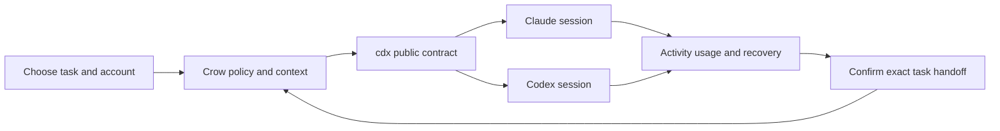

## prod_003_one_crow_hub_for_claude_and_codex - One crow hub for Claude and Codex
> Date: 2026-10-22
> Status: Proposed
> Related request: `req_004_run_claude_and_codex_together_through_cdx`
> Related backlog: `item_010_2_1_public_cdx_contract_and_provider_aware_account_policy`, `item_011_2_2_shared_context_and_enforceable_guard_capabilities`, `item_012_2_3_provider_aware_launch_dispatch_and_helper_jobs`, `item_013_2_4_mixed_provider_activity_and_session_registry`, `item_014_2_5_provider_aware_usage_quota_and_cost_accounting`, `item_015_2_6_exact_resume_and_cross_provider_task_handoff`, `item_016_2_7_provider_identity_across_watch_cli_and_desktop_widgets`, `item_017_2_8_compatibility_regression_onboarding_and_delivery_evidence`
> Related task: `task_003_deliver_joint_claude_and_codex_support_through_cdx`
> Related architecture: (none yet)
> Reminder: Update status, linked refs, scope, decisions, success signals, and open questions when you edit this doc.
> Indicators reviewed: 2026-10-22 16:46:46

# Overview
Run and observe Claude Code and Codex accounts together through cdx, choose the right provider for each task, and transfer interrupted work with its exact source context.

# Goals
- Keep one workflow for mixed-provider interactive work and background jobs.
- Show trustworthy activity and usage without treating missing provider data as zero.
- Preserve account consent, private memory and repository guard behavior during launches and transfers.
- Deliver incrementally over the current account-switching and UI work.

# Non-goals
- Modifying or forking cdx itself.
- Implementing a direct OpenAI or Anthropic API client or installing/logging into user accounts.
- Merging provider-native conversation stores or converting Claude transcripts into Codex sessions.
- Autonomous multi-agent debate, automatic provider fallback, automatic credit resets or a new dashboard layout.
- Running two writers in the same working tree without isolation.

# Scope and guardrails
- In: provider-aware account selection, interactive/headless execution, shared context, activity and usage, exact recovery, terminal and widget consumers, compatibility documentation.
- Out: cdx modifications, direct API execution, native transcript conversion, autonomous provider fallback and unrelated UI redesign.
- Existing Claude-only configuration and the active account-switching work remain supported.

# Key product decisions
- Use cdx public JSON contracts for provider execution, account inventory and run lifecycle.
- Keep native conversation identities separate across providers; link task transfers explicitly.
- Treat unavailable telemetry as unknown and make provider/account provenance visible.
- Gate operations on tested enforcement capabilities, preserving account consent and private context lifetime.

# User flow

# Success signals
- One Claude task and one Codex task complete concurrently in isolated workspaces within the same global slot budget.
- The board and widgets show both providers with accurate lifecycle, measured usage and explicit unknown metrics.
- An explicitly chosen interrupted task can transfer in either direction without confusing native conversation ids.
- Existing Claude-only tests pass and offline mixed-provider regression tests require no credentials.

# References
- Product back-reference: `req_004_run_claude_and_codex_together_through_cdx`
- Task back-reference: `task_003_deliver_joint_claude_and_codex_support_through_cdx`
