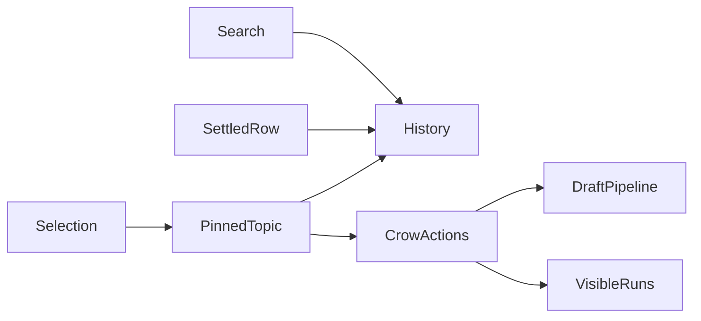

## prod_010_panel_conversation_continuity_and_actions - Panel conversation continuity and actions
> Date: 2026-11-19
> Status: Settled
> Related request: `req_063_panel_persistent_actionable_conversations_and_separate_backup_routine`
> Related backlog: `item_221_deliver_persistent_actionable_panel_chats_and_independent_backup`
> Related task: `task_024_deliver_panel_conversation_continuity_and_actions`
> Related architecture: (none yet)
> Reminder: Update status, linked refs, scope, decisions, success signals, and open questions when you edit this doc.
> Indicators reviewed: 2026-11-19 11:59:48

# Overview
Operate Crow through persistent topic chats with visible runs and independent maintenance routines.

# Goals
- Preserve conversation identity and owner intent.
- Make requested actions available without sending mail.

# Non-goals
- Sending mail
- Pushing or merging the panel branch

# Scope and guardrails
- In: stable panel conversations, action-capable chat, run visibility and separate update/backup controls.
- Out: sending mail, branch publication and the separate Nest terminal.

# Key product decisions
- Preserve topic identity across pending completion and pin it independently of list selection.
- Reuse native Outlook reply-all verification and the local panel action API. Keep no-send instructions and direct send-tool guards.

# Success signals
- A settled conversation reopens from its row, search, recents and related runs.
- Messages retain their intended topic; machine updates no longer execute backups.

# References
- Product back-reference: `item_221_deliver_persistent_actionable_panel_chats_and_independent_backup`
- Task back-reference: `task_024_deliver_panel_conversation_continuity_and_actions`

# Flow

